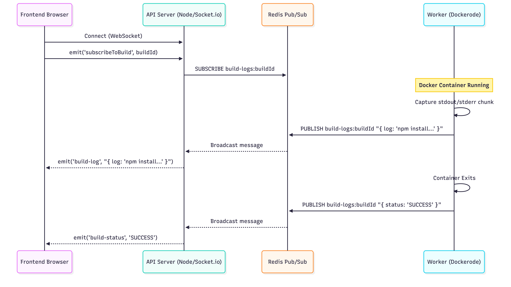
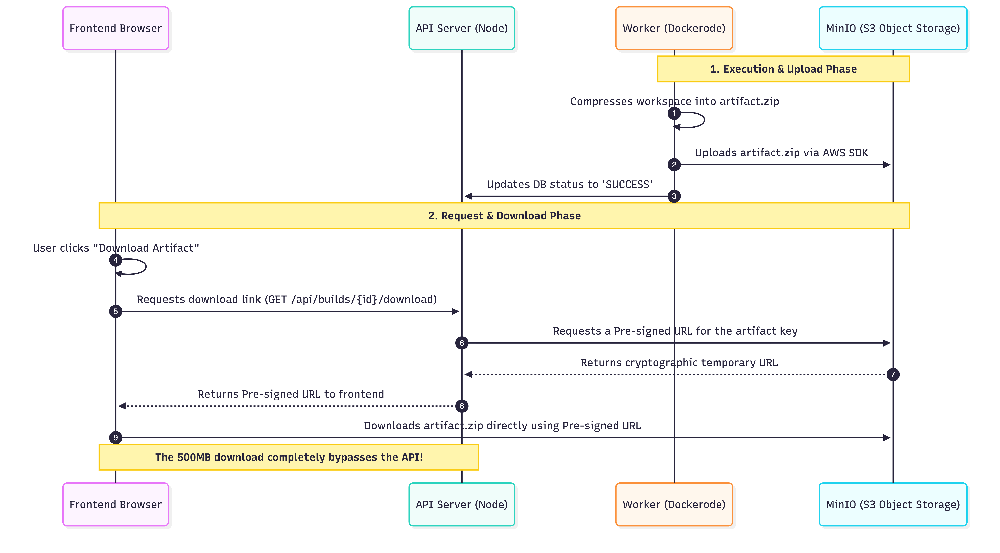

# CloudBuildX 🚀 | Distributed CI/CD Compute Engine


> A highly scalable, distributed Continuous Integration and Continuous Deployment (CI/CD) engine built to securely clone, isolate, and execute GitHub repositories using Docker.

CloudBuildX is a custom-built infrastructure platform similar to GitHub Actions. It features a fully decoupled architecture with a React frontend, an Express REST API, a Redis job queue, and a dedicated Docker-based Worker node that safely executes untrusted code in isolated container environments.

## ✨ Core Engineering Features

*   **Distributed Architecture:** API and Worker servers are decoupled using a BullMQ Redis message broker, with atomic job locking. Workers are stateless, so more can be added to drain the queue faster (production runs 3 PM2 processes on one EC2 instance).
*   **Efficient Data Access:** Redis Cache-Aside pattern (5-minute TTL with invalidation on write) for repository lookups, plus Prisma ORM with parallelized queries (`Promise.all`) for the analytics dashboard and paginated build history.
*   **Security:** Passwords hashed with bcrypt; JWT auth with role-based access control (`USER` / `ADMIN`). Users can only see their own builds, repositories and live log streams (WebSocket connections are authenticated too); admins can see everything.
*   **Input Validation:** Every request body is validated with Zod schemas; invalid requests get a `400` with per-field error details.
*   **Observability:** Structured Winston logging for every request, build start/finish and error, with build metrics (counts, failure rate, duration) logged per worker and exposed platform-wide via an admin endpoint. A single Express error middleware turns any failure into a clean JSON error.
*   **Wake-on-Demand Workers:** Idle workers automatically sleep after 5 minutes and are woken instantly via a Redis Pub/Sub signal when a build is queued, conserving serverless Redis command quotas.
*   **Build Cancellation:** Builds can be cancelled from the UI within the first 15 seconds; the signal is broadcast over Redis Pub/Sub and the worker kills the container mid-execution.
*   **Isolated Execution:** Safely executes untrusted user code inside ephemeral Docker containers, dynamically provisioned via the Docker Engine API with strict host memory and CPU quotas.
*   **Real-Time Telemetry:** Streams raw Docker execution logs (stdout/stderr) directly from the isolated backend containers to the browser in real-time utilizing WebSockets and Redis Pub/Sub.
*   **Pipeline-as-Code:** Utilizes `js-yaml` to parse a repository-level `build.yml` (Docker image + commands), so each repo defines its own build.
*   **Reliable Build Lifecycle:** Builds are claimed atomically with conditional status updates, so a cancelled build never runs or gets overwritten. User build failures are final, and only infrastructure errors are retried with exponential backoff.
*   **Cloud-Native Storage:** Automatically compresses successful build directories into `.zip` artifacts and securely streams them to an Amazon S3 bucket via the AWS SDK.

## 🛠️ Tech Stack

*   **Frontend:** React, TypeScript, TailwindCSS, Socket.io-client, Vite
*   **Backend API:** Node.js, Express, TypeScript, Prisma ORM, Socket.io, Zod, bcrypt, Winston
*   **Worker Engine:** Node.js, Docker API (Dockerode), BullMQ, `js-yaml`, AWS SDK, Winston
*   **Testing:** Jest, Supertest
*   **Database:** Neon (Serverless PostgreSQL)
*   **Message Broker & Cache:** Upstash (Serverless Redis)
*   **Storage:** Amazon Web Services (AWS S3)
*   **Deployment:** Vercel (UI), Amazon EC2 (Backend Compute Node)

## 🧪 Testing the Live Demo

To test the CI/CD pipeline live on the internet:
1. Visit the deployed application: **[CloudBuildX Live Demo](https://cloud-build-gxh6kcxc8-abhi-nsuts-projects.vercel.app/)**
2. Create an account and log in.
3. Paste the URL of the test repository: `https://github.com/Abhi-NSUT/cloudbuildx-demo`
4. On the dashboard, click **"Queue Build"**.
5. Watch the architecture dynamically provision a Docker container, execute the code, and stream the logs live to your browser!

## 💻 Local Development Setup

To run CloudBuildX locally, you must have [Docker Desktop](https://www.docker.com/products/docker-desktop/) installed.

### 1. Clone the repository
```bash
git clone https://github.com/Abhi-NSUT/cloudBuildX.git
cd cloudBuildX
```

### 2. Environment Variables
Copy the example file for both the API and the Worker. The defaults already match the local Docker Compose services:
```bash
cp .env.example .env
cp .env.example worker/.env
```

### 3. Start the Infrastructure (Database, Redis, MinIO)
We use Docker Compose to spin up local instances of PostgreSQL, Redis, and S3-compatible storage (MinIO):
```bash
docker-compose up -d postgres redis minio
```
Then open the MinIO console at http://localhost:9001 (login `admin` / `strongpassword123`) and create a bucket named `cloudbuildx-artifacts`.

> Prefer running everything in containers? `docker-compose up -d --build` starts the API, Worker and UI as well (UI on http://localhost).

### 4. Start the API
```bash
npm install
npx prisma migrate deploy
npm run dev
```

> **Upgrading a database created before migrations existed** (with `prisma db push`)? Mark the baseline as applied once, then deploy the remaining migrations:
> ```bash
> npx prisma migrate resolve --applied 0_init
> npx prisma migrate deploy
> ```

### 5. Start the Worker (In a new terminal)
```bash
cd worker
npm install
npm run dev
```

### 6. Start the Frontend (In a new terminal)
```bash
cd ui
npm install
npm run dev
```

### 7. (Optional) Promote a user to admin
New accounts are always `USER`. There is deliberately no API for granting admin, so promote someone directly in the database, then log in again to get a token with the new role:
```sql
UPDATE users SET role = 'ADMIN' WHERE email = 'you@example.com';
```

## ✅ Running Tests

```bash
npm test
```

The Jest suite covers the auth middleware (missing/forged tokens, roles), the Zod schemas, the real Express app via Supertest (validation errors, login, build ownership, cancellation, and clean 500s), and the worker's build lifecycle (cancelled builds are skipped, build failures are not retried, infrastructure errors are). Prisma, Redis and Docker are mocked so no infrastructure is needed.

## 📡 API Reference

All endpoints return JSON. Errors always look like `{ "error": "message" }`; validation errors also include `details: [{ "field", "message" }]`.
🔒 = requires `Authorization: Bearer <token>`. 👑 = requires the `ADMIN` role.

| Method | Endpoint | Auth | Request body | Success response |
|---|---|---|---|---|
| `GET` | `/api/health` | — | — | `200 { status: "ok", timestamp }` |
| `POST` | `/auth/register` | — | `{ email, password }` (password 8–72 chars) | `201 { message, userId }` · `409` if the email exists |
| `POST` | `/auth/login` | — | `{ email, password }` | `200 { token, role }` (JWT, valid 24h) · `401` invalid credentials |
| `POST` | `/api/repositories` | 🔒 | `{ name, githubUrl }` | `201 { message, repositoryId }` |
| `GET` | `/api/repositories` | 🔒 | — | `200 [ { id, name, githubUrl, userId, createdAt, updatedAt } ]` (Redis-cached, 5 min) |
| `POST` | `/api/builds` | 🔒 | `{ repositoryId: uuid, commitHash?: 7–40 hex chars }` | `201 { message, buildId, status: "PENDING" }` |
| `GET` | `/api/builds?page=&limit=&status=` | 🔒 | — | `200 { data: [build + repository { name, githubUrl }], meta: { total, page, limit, totalPages, hasNextPage, hasPreviousPage } }`. Users get their own builds, admins get all. `limit` max 100. |
| `GET` | `/api/builds/:id` | 🔒 | — | `200 { id, status, commitHash, workerNode, createdAt, startedAt, completedAt, repository }` · `403` if not yours |
| `GET` | `/api/builds/:id/logs` | 🔒 | — | `200` plain-text log of a finished build · `400` while still running |
| `GET` | `/api/builds/:id/artifact` | 🔒 | — | `200 { url }` pre-signed S3 download link (expires in 15 min) · `400` unless `SUCCESS` |
| `POST` | `/api/builds/:id/cancel` | 🔒 | — | `200 { message }` · `400` if finished or older than 15 s |
| `GET` | `/api/analytics` | 🔒 | — | `200 { totalBuilds, successRate, avgDurationSec, byStatus: { SUCCESS: n, FAILED: n, ... } }` (your builds only) |
| `GET` | `/api/admin/metrics` | 🔒👑 | — | `200 { totalUsers, totalBuilds, byStatus, successRate, failureRate, durationSec: { sampleSize, avg, min, max } }` (all builds; durations from the 50 most recent successful builds) |

**WebSocket (Socket.io):** connect with `auth: { token: "Bearer <token>" }`, then emit `subscribeToBuild` with a build ID. You will receive `build-log` events `{ type: "info" | "error" | "system", text }`, but only for builds you own (or any build, if you're an admin).

Build `status` is one of `PENDING`, `RUNNING`, `SUCCESS`, `FAILED`, `CANCELLED`.

## 🏗️ Architecture

### Real-Time Build Log Streaming
Container stdout/stderr is captured by the Worker, published to Redis Pub/Sub, and relayed by the API to the browser over WebSockets.



### Isolated Execution & Artifact Storage
The Worker clones the repository, runs it inside a resource-limited Docker container (512 MB RAM, 50% CPU) via Dockerode, then zips the output and streams it to S3. Artifacts are downloaded through short-lived pre-signed URLs.



## 🔐 Security Model & Trade-offs

CloudBuildX runs untrusted code, so it's worth being explicit about what is and isn't isolated:

| Area | Current approach | Next step |
|---|---|---|
| Build isolation | Each build runs in a fresh Docker container with a 512 MB memory cap, 50% CPU quota, `no-new-privileges`, a 10-minute timeout, and only its own workspace mounted. | Run builds under gVisor or Firecracker microVMs for kernel-level isolation. |
| Worker privileges | The worker talks to Docker through the mounted host socket, which is effectively root on the host. Acceptable for a single-tenant demo box. | Use a rootless Docker daemon or a separate build host the API can't reach. |
| Network | Build containers have network access (needed for `npm install`). | Egress allow-list (package registries only). |
| Transport | The UI is served over HTTPS by Vercel, which proxies to the EC2 backend over HTTP. | Terminate TLS on EC2 (Caddy/nginx + Let's Encrypt) or put it behind an ALB. |
| Auth | bcrypt password hashes, 24h JWTs carrying the role, ownership checks on every build lookup and WebSocket subscription. The JWT is stored in `localStorage`. | httpOnly cookies + CSRF protection; restrict CORS to the UI origin. |

## 🐛 Known Issues & Future Improvements
- **GitHub Webhooks:** Implement GitHub App webhooks to automatically trigger builds when code is pushed to the `main` branch.
- **GitHub OAuth:** Replace JWT email authentication with direct GitHub OAuth integration.

---

*Designed and engineered by Abhijeet Singh.*